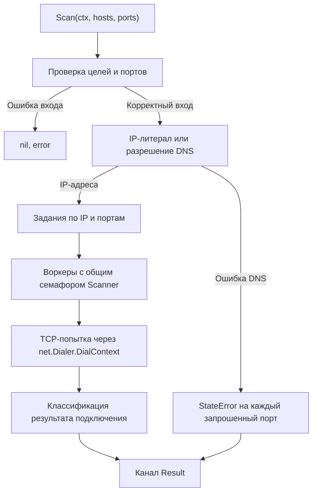

# TCP Scanner

`tcpscanner` — Go-пакет для проверки доступности TCP-портов на IPv4, IPv6 и DNS-целях. Он использует TCP Connect и сразу закрывает успешно установленные соединения. Пакет рассчитан на Go 1.25.5 и использует стандартную библиотеку.

## Быстрый старт

Создайте модуль для примера и подключите опубликованный TCP Scanner.

```sh
mkdir tcpscanner-demo
cd tcpscanner-demo
go mod init example.com/tcpscanner-demo
go get github.com/BarracudaMVP/TCPScanner
```

Сохраните пример в `main.go` и выполните `go run .`. Он проверяет выбранные порты локальной машины. Результаты зависят от запущенных на ней служб.

```go
package main

import (
    "context"
    "fmt"
    "log"
    "time"

    "github.com/BarracudaMVP/TCPScanner"
)

func main() {
    scanner, err := tcpscanner.New(tcpscanner.Config{
        Concurrency:    32,
        ConnectTimeout: 500 * time.Millisecond,
    })
    if err != nil {
        log.Fatal(err)
    }

    ctx, cancel := context.WithTimeout(context.Background(), 10*time.Second)
    defer cancel()

    results, err := scanner.Scan(ctx, []string{"127.0.0.1", "localhost"}, tcpscanner.Ports{
        List:   []int{443},
        Ranges: []tcpscanner.PortRange{{From: 8080, To: 8082}},
    })
    if err != nil {
        log.Fatal(err)
    }
    for result := range results {
        fmt.Printf("%s %s %d %s (%s)\n", result.Host, result.IP, result.Port, result.State, result.Duration)
        if result.Err != nil {
            log.Print(result.Err)
        }
    }
    if err := ctx.Err(); err != nil {
        log.Print(err)
    }
}
```

## API и результаты

- `New(Config) (*Scanner, error)` принимает положительные `Concurrency` и `ConnectTimeout`. `Concurrency` ограничивает суммарное число активных подключений одного экземпляра, включая одновременные вызовы `Scan`. `ConnectTimeout` отсчитывается с начала TCP-подключения после разрешения DNS и ожидания слота.
- `(*Scanner).Scan(ctx, hosts, ports) (<-chan Result, error)` проверяет вход перед стартом. Ошибки входа и уже завершённый контекст возвращаются сразу. После старта результаты и ошибки отдельных проверок приходят через канал. Их порядок зависит от времени выполнения проверок.
- `Ports` объединяет `List []int` и `Ranges []PortRange`. Каждый `PortRange` включает `From` и `To`. Повторы учитываются один раз. Пустой набор, обратный диапазон и значения за пределами `1..65535` дают ошибку.
- `Result` содержит исходное написание `Host`, адрес `IP` типа `netip.Addr`, `Port`, `State`, `Duration` TCP-подключения и `Err` с исходной причиной ошибки.

Передавайте хост без порта. IPv6 указывается без квадратных скобок и может включать зону, например `fe80::1%eth0`. Пустой список хостов, пустые или некорректные цели и неопределённые IP `0.0.0.0` и `::` дают ошибку входа. IPv4-mapped IPv6 приводятся к IPv4. Для повторов одной цели сохраняется первое входное написание. Регистр ASCII DNS-имени при сравнении игнорируется, а конечная точка сохраняется, поскольку влияет на разрешение имени.

DNS-имя разрешается один раз за вызов `Scan`. Если оно указывает на несколько IP, канал выдаёт результат для каждого уникального сочетания цели, IP и порта. Разные имена остаются отдельными целями. Если DNS не вернул пригодных адресов, для каждого порта этой цели выдаётся `error` с нулевыми `IP` и `Duration` и причиной в `Err`. Другие цели продолжают обрабатываться.

| `State` | Значение |
| --- | --- |
| `open` | Соединение установлено. `Err` равен `nil`. |
| `closed` | ОС вернула явный отказ в соединении. |
| `timeout` | Истёк лимит TCP-подключения или ОС вернула сетевой таймаут. |
| `unreachable` | ОС сообщила о недоступности узла или сети. |
| `canceled` | Подключение прервано отменой или дедлайном контекста вызова. |
| `error` | Другая ошибка подключения или ошибка DNS. |

## Архитектура

| Файл или пакет | Ответственность |
| --- | --- |
| `scanner.go` | `Config`, `Scanner` и `New`. Настройка резолвера, TCP-клиента и общего лимита подключений. |
| `scan.go` | `Scan`, подготовка заданий, воркеры, таймауты, отмена и закрытие канала результатов. |
| `ports.go` | Проверка списка и диапазонов, объединение портов без повторов. |
| `result.go`, `classify.go` | Публичные `Result` и `State`, перевод ошибок подключения и контекста в состояние порта. |
| `internal/target` | Проверка и дедупликация целей, разрешение DNS-имён в IP-адреса. |
| `internal/socketerr` | Интерпретация системных кодов ошибки TCP. Реализация выбирается при сборке для Unix или Windows. Остальные платформы используют общую классификацию. |



`classify.go` различает дедлайн самого подключения и отмену контекста вызова. Для системных ошибок он опирается на `internal/socketerr`. Например, `ECONNREFUSED` на Linux и `WSAECONNREFUSED` на Windows дают одинаковый `StateClosed`. Исходная ошибка подключения доступна в `Result.Err`.

## Чтение и отмена

Читайте канал до закрытия. Если прекращаете чтение раньше, вызовите `cancel()` перед выходом. Заполнение буфера при медленном чтении приостанавливает работу соответствующего вызова `Scan`. Установленные соединения к этому моменту уже закрыты, поэтому медленный читатель не удерживает слоты других вызовов.

```go
ctx, cancel := context.WithCancel(parent)
defer cancel()

results, err := scanner.Scan(ctx, hosts, ports)
if err != nil {
    return err
}
for result := range results {
    if result.State == tcpscanner.StateOpen {
        cancel()
        break
    }
}
```

После отмены поток может содержать только часть результатов. Канал закрывается после завершения горутин вызова. `ctx.Err()` позволяет проверить состояние переданного контекста.

## Документация API

Справка по публичному API генерируется из комментариев Go. Для просмотра из корня репозитория используйте `go doc -all .`.

GitHub Actions сохраняет текст справки в артефакте `api-docs` успешного прогона. [Запуски GitHub Actions](https://github.com/BarracudaMVP/TCPScanner/actions)

Для публичного модуля документация отображается на pkg.go.dev после индексации при наличии распознаваемой лицензии. [Страница пакета](https://pkg.go.dev/github.com/BarracudaMVP/TCPScanner) · [Политика лицензий](https://pkg.go.dev/license-policy)

## Тесты

GitHub Actions запускает `go vet ./...` и `go test -race ./...` на Linux с Go 1.25.5 при push и pull request. Тесты проверяют валидацию, обработку DNS и сетевых ошибок, TCP-подключения к loopback, общий лимит и отмену.

Запускайте тесты из корня клона. Для `-race` нужны включённый cgo и доступный компилятор C. В Linux и macOS выполните следующие команды.

```sh
GOTOOLCHAIN=go1.25.5 go version
GOTOOLCHAIN=go1.25.5 CGO_ENABLED=1 go test -race ./...
```

На Windows используйте MinGW-w64. Команда проверки библиотеки ниже должна вернуть полный путь к `libsynchronization.a`. Если `gcc` находится вне `PATH`, укажите полный путь к `gcc.exe` в `CC`.

```powershell
$env:GOTOOLCHAIN = 'go1.25.5'
$env:CGO_ENABLED = '1'
$env:CC = 'gcc'
& $env:CC --print-file-name libsynchronization.a
go version
go test -race ./...
```
